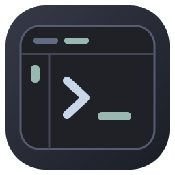
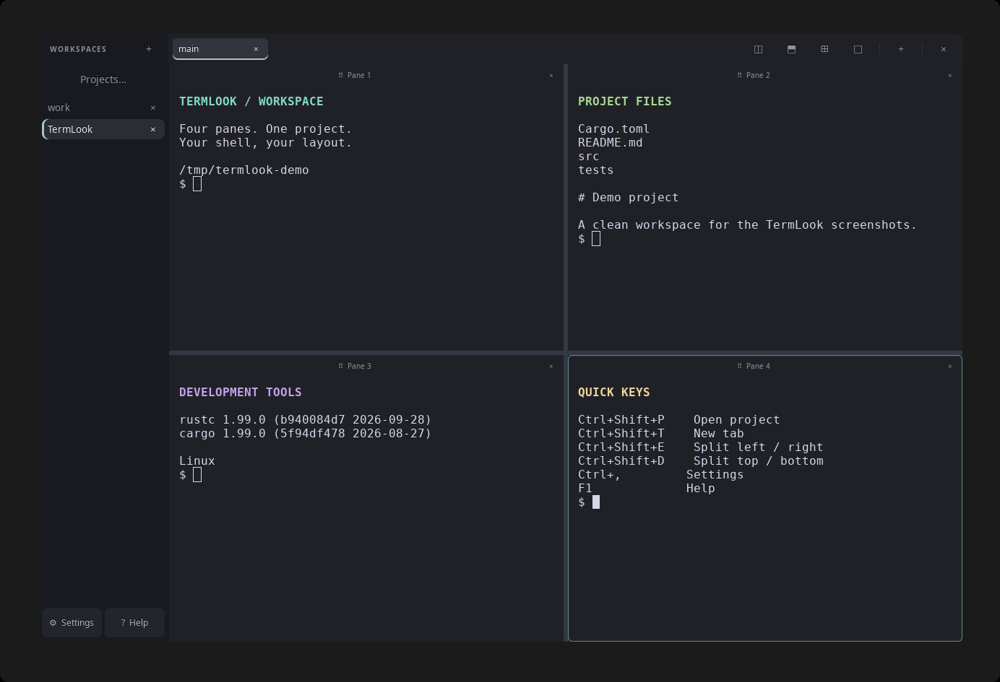
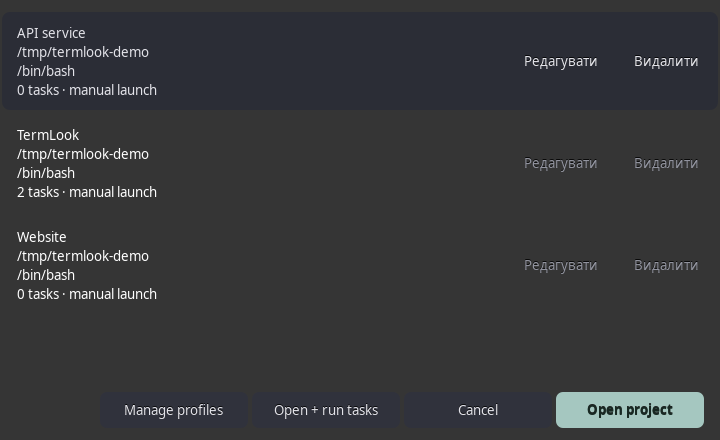
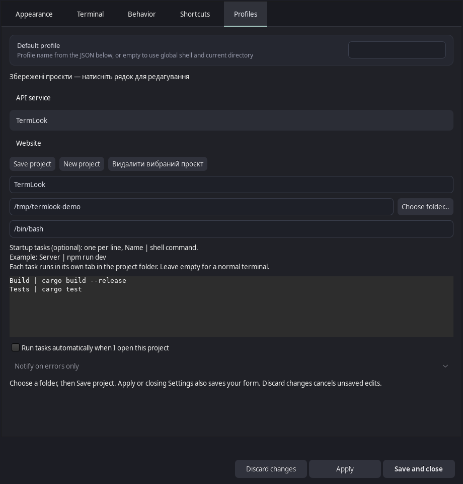
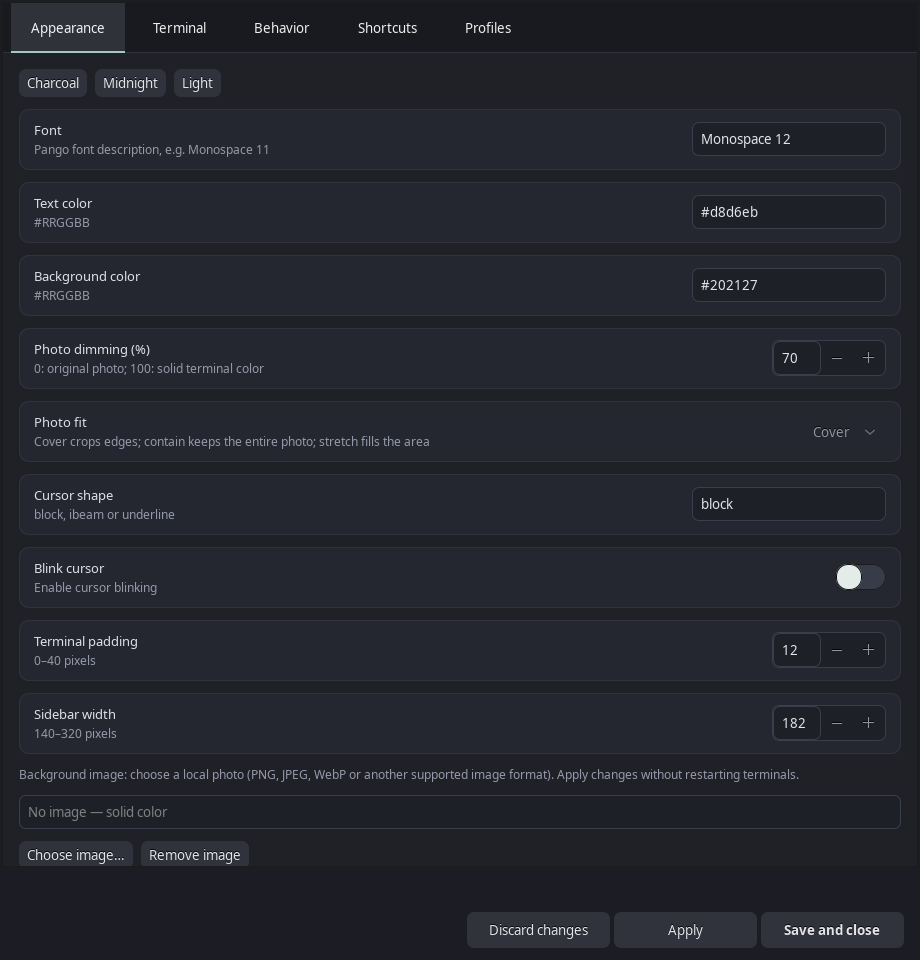

<p align="center">
  
</p>
<h1 align="center">TermLook</h1>
<p align="center"><strong>A workspace for every project.</strong><br>
A native Linux terminal with split panes, project profiles, startup tasks, and live customization.</p>
<p align="center">
  <a href="#installation">Installation</a> ·
  <a href="#projects">Projects</a> ·
  <a href="#startup-tasks-and-logs">Tasks &amp; logs</a> ·
  <a href="#customization">Customization</a> ·
  <a href="CONTRIBUTING.md">Contributing</a>
</p>



TermLook is written in **Rust**, with **GTK 3** for its interface and **VTE** for
terminal emulation. Run your own shell, keep projects in separate workspaces, and
watch commands and logs side by side. No Python runtime is required.

## Features

- **Workspaces and tabs** — organize terminals by project and switch without stopping running commands.
- **Up to four panes per tab** — split horizontally or vertically, resize dividers, swap panes by dragging their headers, or focus a single pane.
- **Saved projects** — choose a folder and shell, then open, edit, or delete the profile from a visible list.
- **Startup tasks** — launch a project's commands in separate tabs with live output, exit status, and optional desktop notifications.
- **Personal appearance** — change fonts, colors, cursor style, shortcuts, and background images without restarting shells.
- **Confirmed closing** — closing a pane, tab, workspace, or quitting asks before ending sessions.
- **Layout restoration** — restore workspace names, tabs, directories, and split geometry on the next launch.

Screenshots show the Rust application with a temporary demo project, not personal files.

## Installation

### Build from source

On Ubuntu 24.04, install a current stable [Rust toolchain](https://rustup.rs/) and the native development libraries:

```sh
sudo apt update
sudo apt install build-essential pkg-config libgtk-3-dev libvte-2.91-dev librsvg2-common

git clone https://github.com/SyntaxForge-T/Termlook.git
cd Termlook
cargo run --release --locked
```

To run an existing build, use `./target/release/termlook`.

### Install for your user

From the repository directory:

```sh
./scripts/install_desktop.sh
```

This installs the binary to `~/.local/bin/termlook` and adds an application-menu
entry. Add `~/.local/bin` to your `PATH` if you want to launch it as `termlook`
from another terminal.

### Build a Debian package

```sh
./scripts/build_deb.sh
sudo apt install ./dist/termlook_0.4.2_amd64.deb
```

The package architecture follows the build machine; adjust the filename on other
architectures. See [packaging details](docs/packaging.md).

**Updating:** quit the old instance completely before opening the new one.
TermLook is a single-instance application, so launching it while an older copy
is running brings that existing window to the front.

## Projects



1. Open **Projects… → Manage profiles**, or **Settings → Profiles**.
2. Choose a folder. Enter a project name, or leave it blank to use the folder name.
3. Optionally choose a shell executable such as `/bin/bash` or `/bin/zsh`.
4. Click **Save project**. **Apply**, **Save and close**, and the settings window's close button also save the form.
5. Open **Projects…**, select the project, and click **Open project**.

Each profile opens its own workspace. Opening the same project again selects
that workspace without creating a duplicate.

Saved profiles appear in a visible list above the settings form. Select a row
to edit it; use **New project** to create another. Invalid entries keep the
settings window open and show an error. **Discard changes** cancels unsaved edits.

In **Projects…**, every profile has **Редагувати** (Edit) and **Видалити** (Delete)
buttons. Confirmed deletion is saved immediately. It removes the profile, while
its folder, files, and running terminals remain. Save or discard an open settings
draft before deleting from the project manager.

## Startup tasks and logs



In **Settings → Profiles**, enter one task per line using `Name | command`:

```text
Server | npm run dev
Tests | npm test
Logs | tail -f app.log
```

These are examples; use commands that exist in your project. Leave the task
field empty to open a normal terminal. Enable **Run tasks automatically when I
open this project**, then save the profile.

- Each task runs in its own terminal tab, concurrently, from the project folder.
- Standard output and error output appear directly in the terminal.
- Tabs show **▶** while running, **✓** on success, or **✗** with an exit code or termination signal.
- Choose notifications for **errors only**, **every completion**, or **off**.
- **Open project** launches the template once per workspace during the current app session.
- **Open + run tasks** reruns a finished template in fresh tabs. It refuses while any template task is still running.

Use **Ctrl+C** to stop a foreground command, or close its tab with confirmation.
Keep servers in the foreground rather than adding `&`, so their completion
status follows the running process. Up to **12 tasks** can be saved per profile.

Tasks use the selected shell with `-c`; interactive shell startup files may not
load. Put required environment setup in the command or a project script.
Failure status comes from the process exit status, not from matching words in logs.
Desktop notifications require a notification service on your desktop.

## Customization



Open **Settings** with **Ctrl+,**. Appearance changes apply to existing terminals
without interrupting their shells.

| Settings page | What you can change |
| --- | --- |
| Appearance | Font, text/background colors, ANSI palette, cursor, spacing, sidebar width, and background image |
| Terminal | Shell, scrollback, bell, and scrolling behavior |
| Behavior | Close-to-tray/minimize behavior and tab close buttons |
| Shortcuts | Application shortcuts; an empty binding disables the action |
| Profiles | Project names, folders, shells, startup tasks, and notifications |

For a custom background, select **Appearance → Choose image…**, choose a local
image, and adjust dimming and **cover**, **contain**, or **stretch** fitting.
Keep the image at its selected path. Supported formats depend on your system's
image loader; common formats include PNG and JPEG.

Configuration lives in `~/.config/termlook/`, or `$XDG_CONFIG_HOME/termlook/`:

| File | Purpose |
| --- | --- |
| `settings.json` | Appearance, shortcuts, profiles, and tasks |
| `layout.json` | Workspace, tab, directory, and pane layout |
| `theme.css` | Optional custom GTK interface styling |

Print default settings with `termlook --print-default-settings`. After editing
configuration files, press **Ctrl+Shift+R** to reload. Invalid settings reloads
leave the active settings unchanged.

## Keyboard shortcuts

| Action | Default shortcut |
| --- | --- |
| Open projects | Ctrl+Shift+P |
| New tab / workspace | Ctrl+Shift+T / Ctrl+Shift+N |
| Close tab / pane | Ctrl+Shift+W / Ctrl+Shift+X |
| Split left/right / top/bottom | Ctrl+Shift+E / Ctrl+Shift+D |
| Focus pane / show all | Ctrl+Shift+Enter |
| Next / previous tab | Ctrl+Tab / Ctrl+Shift+Tab |
| Copy / paste | Ctrl+Shift+C / Ctrl+Shift+V |
| Rename tab | F2 |
| Settings / reload | Ctrl+, / Ctrl+Shift+R |
| Help | F1 |
| Quit | Ctrl+Shift+Q |

**F1** opens quick-start guidance, searchable shortcuts, customization help, and
**Проєкти**, a Ukrainian guide to project creation, tasks, logs, and deletion.
Tooltips reflect your configured shortcuts. Right-click a terminal for Copy/Paste;
**Ctrl+C** retains its normal role of interrupting the foreground command.

## Session behavior

Switching tabs or workspaces keeps opened sessions running. Restored tabs start
their shells lazily when selected, while project tasks start when explicitly
launched through the project workflow.

**Restarting restores the layout, not running processes or scrollback.** Logs
remain in their tabs until the tab or application closes and are not automatically
archived to disk. Open a profile from **Projects…** after restarting to launch
its tasks again. Directory tracking uses the shell's OSC 7 support; otherwise
the initially configured directory is retained.

With background mode enabled, closing the main window hides it if an AppIndicator
host is available, or minimizes it otherwise. Use **Quit** to end the application.
Optional Ubuntu tray integration:

```sh
sudo apt install libayatana-appindicator3-1 gnome-shell-extension-appindicator
```

Enable the desktop's AppIndicator extension. Disabling background mode makes
window close ask before quitting. Native Windows is not supported.

## Development

```sh
cargo fmt --check
cargo clippy --locked --all-targets -- -D warnings
cargo test --locked
```

GUI lifecycle checks require a display or Xvfb. Build instructions, GUI tests,
and contribution guidelines are in [CONTRIBUTING.md](CONTRIBUTING.md).

TermLook uses lazy terminal creation, cached interface widgets, and coalesced
layout writes. Release builds enable thin LTO and strip symbols. These are
implementation choices, not a claim of benchmarked speed improvements.

## License

[MIT](LICENSE) · [Contributors](CONTRIBUTORS.md)
